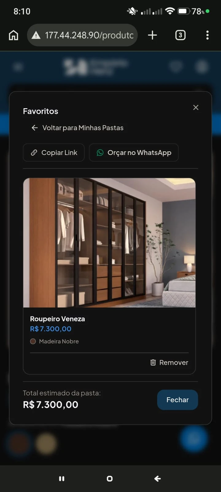
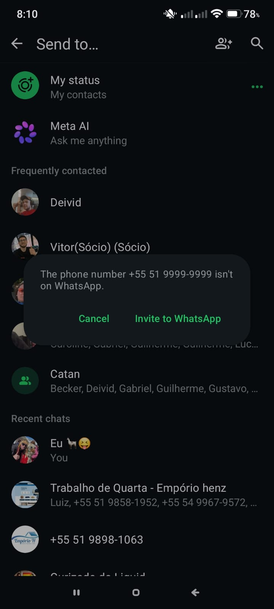

# 003 · "Orçar no WhatsApp" abre um número fictício

| Campo      | Valor                                                  |
| ---------- | ------------------------------------------------------ |
| Data       | 2026-10-29                                             |
| Status     | resolvido (aguardando deploy)                          |
| Severidade | alta                                                   |
| Camada     | [FE]                                                   |
| Tela       | Modal "Minhas listas" → pasta aberta → "Orçar no WhatsApp" |
| Referência | PRD UC05 / UC06 (orçamento pela lista)                 |

## O que acontece

No servidor publicado (`177.44.248.90`), ao abrir uma pasta (ex.: "Favoritos") e tocar em "Orçar no WhatsApp", o WhatsApp abre a conversa com **+55 51 9999-9999** e avisa que o número não está no WhatsApp. O pedido de orçamento não chega à loja.

## O que deveria acontecer

O botão abre a conversa com o WhatsApp oficial da loja, com a mensagem pré-preenchida (nome da pasta, itens e link da lista).

## Como reproduzir

1. Entrar no site publicado pelo celular.
2. Salvar um produto em uma pasta e abrir "Minhas listas" → a pasta.
3. Tocar em "Orçar no WhatsApp".
4. O WhatsApp informa que +55 51 9999-9999 não está no WhatsApp.

## Notas técnicas

- Causa: `frontend/src/components/listas/MinhasListasModal.vue` tinha o número fixo `const storePhone = "5551999999999"` em `openWhatsApp()`.
- O link da lista também era montado com `window.location.origin`, que em produção pode não ser a URL pública da loja.

## Correção

- `frontend/src/data/contato.json` centraliza o WhatsApp da loja (`whatsapp`) e a URL pública (`siteUrl`).
- `frontend/src/utils/phone.ts`: `storeWhatsappUrl(message)` monta o `wa.me` com o número oficial; `storeSiteUrl(path)` monta o link usando `siteUrl` ou, se vazio, a origem atual.
- `MinhasListasModal.vue` usa `storeWhatsappUrl` e `storeSiteUrl` em "Orçar no WhatsApp" e "Copiar Link". `UiFloatingActions`, `AppFooter`, `AboutView` e `CatalogoProdutoDetalheView` leem o mesmo `contato.json`.
- Pendente: publicar esta branch no servidor e repetir o roteiro acima, conferindo se a conversa abre com o número oficial.

## Print

