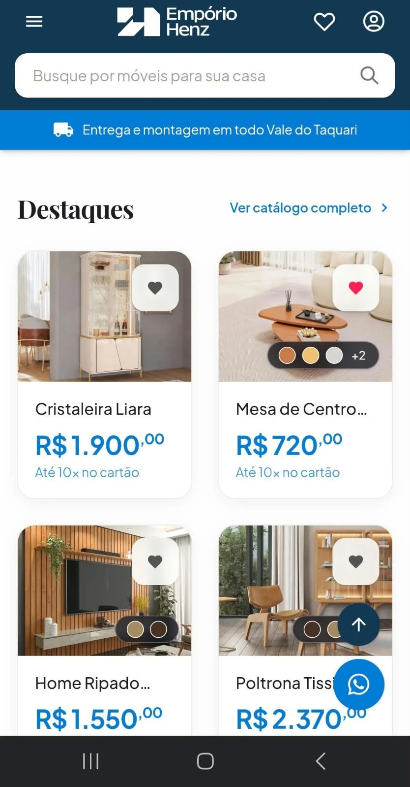

# 004 · Botões flutuantes cobrem nome e preço dos cards no celular

| Campo      | Valor                                              |
| ---------- | -------------------------------------------------- |
| Data       | 2026-10-29                                         |
| Status     | aberto                                             |
| Severidade | média                                              |
| Camada     | [FE]                                               |
| Tela       | Home (Destaques), catálogo — grade de 2 colunas no celular |
| Referência | —                                                  |

## O que acontece

No celular, com a grade de duas colunas, o botão flutuante do WhatsApp e o "Voltar ao topo" ficam por cima da coluna da direita. No print, eles tapam o nome ("Poltrona Tissi…") e o preço do card. O "Voltar ao topo" também cobre a bolinha de cores do produto.

## O que deveria acontecer

Nome, preço e seletor de cores dos cards ficam legíveis em qualquer posição de rolagem. Os botões flutuantes podem ficar sobre a imagem ou sobre o espaço entre os cards, mas não sobre o texto.

## Como reproduzir

1. Abrir a home no celular (largura ~375–412px).
2. Rolar até a seção "Destaques" até aparecer o botão "Voltar ao topo".
3. Observar o card da coluna da direita alinhado com os botões: nome e preço ficam escondidos.

## Notas técnicas

- `frontend/src/components/ui/UiFloatingActions.vue` (renderizado pelo `AppFooter.vue`): bloco `fixed bottom-6 right-6 z-40` com "Voltar ao topo" (`w-10 h-10`) e WhatsApp (`UiFloatingButton size="lg"`), empilhados na vertical.
- Opções para triar:
  - Reduzir os botões no celular (WhatsApp `md`, topo `w-9 h-9`) e encostar mais na borda (`bottom-4 right-4`).
  - Colocar "Voltar ao topo" ao lado do WhatsApp em vez de em cima, ocupando menos altura.
  - Esconder o WhatsApp flutuante enquanto a grade de produtos está visível, ou mostrá-lo só depois de parar a rolagem.
  - Garantir `padding-bottom` na página para o último card não ficar sempre embaixo dos botões.
- Conferir também `ProdutoDetalheView`, onde o botão pode cobrir as ações do produto.

## Print

